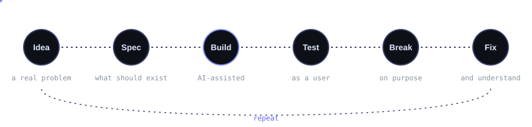

<b>English</b> · <a href="#-español">Español</a>

## About

I'm Jorge, from Galicia. I came to software from **WordPress and creative work**, and I build tools I need and couldn't find: streaming overlays, messaging automation, small self-hosted utilities.

I use AI as a coding assistant. My part is the problem definition, the specification, the design and architecture, and a lot of testing.

> I use AI to help me build. I still want to understand what I'm building.

## Projects

## How I work

A few things I try to keep in every project:

| | |
|---|---|
| 🏠 **Local-first** | Runs on your machine; data stays with you unless you decide otherwise. |
| 🛡️ **Host in control** | An AI can request an action. The host decides whether it is allowed. |
| 🌍 **Bilingual** | Interfaces and docs in English and Spanish. |
| 🔍 **Transparent** | Open about how things are built, including the use of AI. |

## Tools

## Activity

---

<b>🇪🇸 Español</b>

 

### Sobre mí

Soy Jorge, de Galicia. Llegué al software desde **WordPress y el trabajo creativo**, y construyo las herramientas que necesito y no encuentro: overlays para streaming, automatización de mensajería y pequeñas utilidades autoalojadas.

Uso la IA como asistente de programación. Mi parte es definir el problema, la especificación, el diseño y la arquitectura, y probar mucho.

> Uso la IA para ayudarme a construir. Sigo queriendo entender lo que construyo.

### Proyectos

- [**Open Stream Suite**](https://github.com/AndorinaAI/open-stream-suite): overlays, alertas y widgets para Twitch y OBS Studio, con panel de control local.
- [**Andoriña**](https://github.com/AndorinaAI/Andorina-WhatsApp-Agent-for-Hermes): gestor de WhatsApp para Hermes Agent. El LLM solicita acciones; el host decide.
- [**Songifree**](https://github.com/AndorinaAI/songifree): peticiones musicales desde el chat: Spotify para Twitch, Kick y TikTok, con overlay.

### Cómo trabajo

Idea → especificación → desarrollo (con IA) → pruebas → romperlo a propósito → arreglarlo → repetir.

- 🏠 **Local primero:** se ejecuta en tu equipo; los datos se quedan contigo salvo que decidas lo contrario.
- 🛡️ **El host manda:** una IA puede pedir una acción; el host decide si se permite.
- 🌍 **Bilingüe:** interfaces y documentación en inglés y español.
- 🔍 **Transparente:** abierto sobre cómo se construye todo, incluido el uso de IA.

<i>Andoriña</i> is Galician for <i>swallow</i>.

